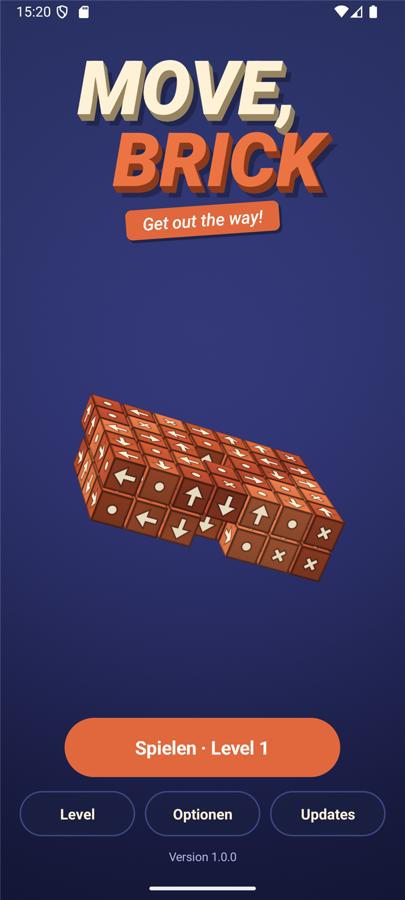
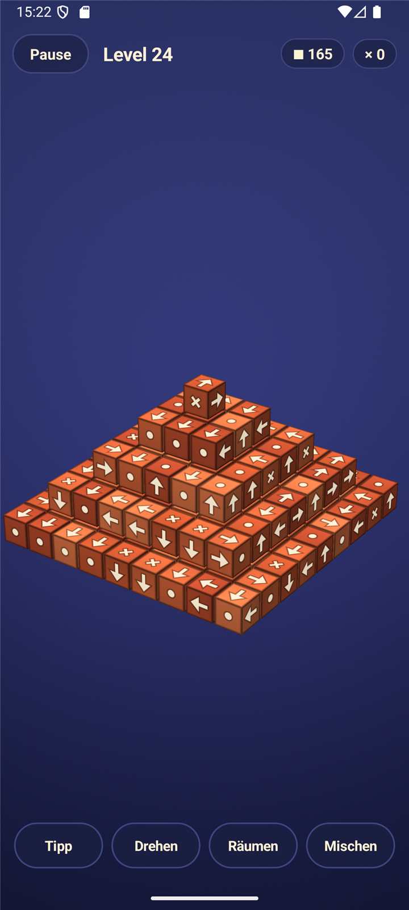
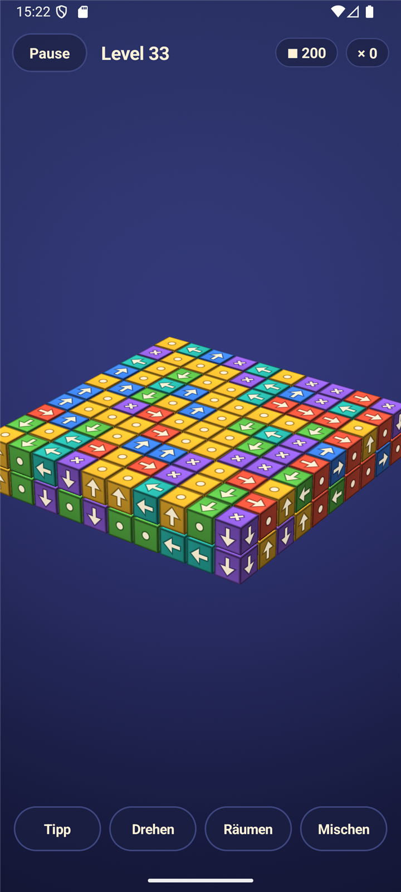

# Move, Brick

**Get out the way!**

A 3D puzzle for Android. A figure built of bricks floats in space, and every brick
carries an arrow. Tap a brick and it flies off along its arrow, but only if no other
brick stands in its way. Clear them all and the level is done.

  
  
  
   
  <em>Move, Brick 1.0.0 · Screenshots from an Android 16 emulator, November 24, 2026</em>

**[Download the latest version](https://github.com/ShakieVan/MoveBrick/releases/latest)**
· [Installing and updating](INSTALLATION.md) · [Privacy](PRIVACY.md)

## What you get

- **Tap, turn, zoom:** a tap sends a brick off or makes it bump into the one in its
  way. Drag to turn the figure, use two fingers to zoom and to shift it.
- **Readable from every side:** an arrow shows where a brick goes. A dot means it
  comes towards you, a cross means it goes away from you.
- **Endless levels:** they are computed, start with a handful of bricks and grow to
  about 300, as cubes, walls, stairs, pyramids, crosses, balls, rings and more.
  Every level can be solved.
- **No clock unless you want one:** playing against time is an option and is off
  at first. There is no limit of moves; a nearly clean run earns three stars.
- **Help when you are stuck:** a hint lets a free brick flash. Once per level each,
  you can turn all arrows around, clear five bricks, or shuffle the arrows.
- **Colour aid:** optionally the colour of a brick shows its direction.
- **Your level waits:** a level you leave is kept and continued later.
- **No advertising, no purchases, no account.** The internet is used only to look
  for updates.

The app's texts are currently in German.

## Requirements

Android 9 or later and OpenGL ES 3.0. The app is distributed as an APK from this
page, outside Google Play, and updates itself from here when you ask it to.

## What was checked

Version 1.0.0 was played on an Android 16 emulator: the first levels to the end,
a level of about 300 bricks, the hint and the three helps, pause, options and
continuing a level. On a Galaxy S21 (Android 15) the start, the first level and one
move were looked at. Sound, vibration and the two-finger gestures were not checked
before publication. Update results are listed in [INSTALLATION.md](INSTALLATION.md).

## About this repository

This repository distributes the app: release files, checksums and these documents.
It does not contain the source code, and being public does not grant an open-source
license to the app. Licenses of the libraries inside the app are listed in
[THIRD_PARTY_NOTICES.md](THIRD_PARTY_NOTICES.md).

## Version history

- **1.0.0** (November 24, 2026): first public version.
