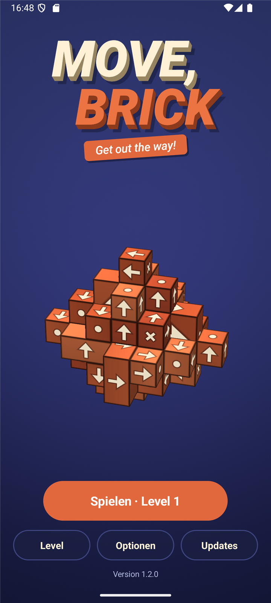
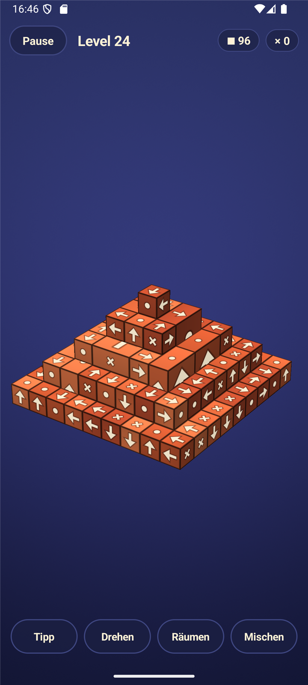
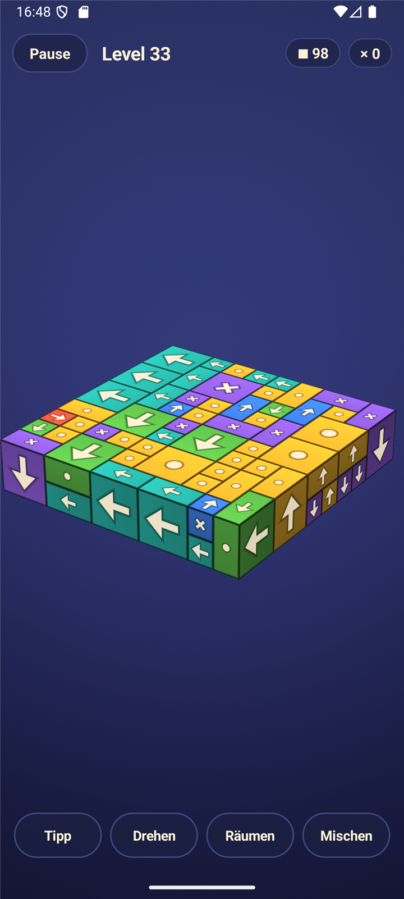

# Move, Brick

**Get out the way!**

A 3D puzzle for Android. A figure built of bricks floats in space, and every brick
carries an arrow. Tap a brick and it flies off along its arrow, but only if no other
brick stands in its way. Clear them all and the level is done.

  
  
  
   
  <em>Move, Brick 1.2.0 · Screenshots from an Android 16 emulator, November 24, 2026</em>

**[Download the latest version](https://github.com/ShakieVan/MoveBrick/releases/latest)**
· [Installing and updating](INSTALLATION.md) · [Privacy](PRIVACY.md)

> [!WARNING]
> **Google Play Protect blocked version 1.0.0 in a test on November 24, 2026**
> ("this app may be harmful", without naming a reason). VirusTotal reported 0 of 64
> detections for the same file. The classification is unexplained and not cleared.
> Details: [INSTALLATION.md](INSTALLATION.md#google-play-protect).

## What you get

- **Tap, turn, zoom:** a tap sends a brick off or makes it bump into the one in its
  way. Drag to turn the figure, use two fingers to zoom and to shift it. Since
  1.1.1 the figure stays upright while you turn it: up is always up. Since 1.5.1
  two fingers zoom in on the spot between them and shift the view, and the
  figure turns around what is in the middle of the screen.
- **Readable from every side:** an arrow shows where a brick goes. A dot means it
  comes towards you, a cross means it goes away from you.
- **Endless levels:** they are computed, start with a handful of bricks and grow to
  figures of about 300 cells, as cubes, walls, stairs, pyramids, crosses, balls,
  rings and more.
- **Large bricks** (since 1.2.0): from level 10 on, some bricks are plates covering
  four cells. They need a free way across their whole width.
- **No clock unless you want one:** playing against time is an option and is off
  at first. There is no limit of moves; a nearly clean run earns three stars.
- **Two kinds of level** (since 1.1.0): "Solvable" arranges the arrows so
  that every figure can be cleared. "Chance" leaves them to pure chance;
  the figure usually gets stuck, and the app tells you when no brick can leave.
- **Concentration** (since 1.3.0, from level 15 on, can be switched off): one wrong
  move blows the whole figure up and the level starts again. Since 1.4.0 a fuse
  burns first: the brick that was hit glows and beeps for five seconds.
- **Ultrahard** (since 1.3.0): a second mode with endless levels of its own. Only
  very large figures that grow with every level, a wrong move always blows them
  up, and there are no hints or helps. It opens once levels 1 to 20 are done with
  concentration switched on. Which level have you reached?
- **Help when you are stuck:** a hint lets a free brick flash; since 1.4.0 the next
  hint has to wait (15 minutes in level 1, a minute more with every level, in
  real time). You can also turn all
  arrows around, clear five bricks, or shuffle the arrows: once per level each in
  solvable levels, without limit in levels of chance.
- **Signs as you like them:** the dot and the cross can be switched off (since
  1.1.0), and optionally the colour of a brick shows its direction.
- **Two views** (since 1.4.0): nearly parallel edges, much like an isometric
  drawing, or as an option a wide-angle perspective.
- **Your level waits:** the level is stored after every move (since 1.4.0) and
  continued later, one for the normal levels and one for Ultrahard.
- **No advertising, no purchases, no account.** The internet is used only to look
  for updates.

The app speaks German and English (since 1.5.0). At first the phone's language
decides; the options switch between the two.

## Requirements

Android 9 or later and OpenGL ES 3.0. The app is distributed as an APK from this
page, outside Google Play, and updates itself from here when you ask it to.

## What was checked

For version 1.5.1 the gestures of two fingers were played by a test tool that
sends finger movements, not by a hand: zooming, shifting, turning and a hint in
a shifted view, with a test build on a Galaxy S10 (Android 16, LineageOS) on a
figure of 155 bricks in both views, and zooming, shifting and turning with the
published file on an Android 16 emulator.

Versions 1.1.0 to 1.5.0 were played on an Android 16 emulator: both kinds of
level, the options, the helps, the upright turning, the large bricks,
concentration with its fuse, the Ultrahard mode, the wait for hints, saving
after every move, the perspective view and both languages; they were not
checked on a phone.

Version 1.0.0 was played on an Android 16 emulator: the first levels to the end,
a level of about 300 bricks, the hint and the three helps, pause, options and
continuing a level. On a Galaxy S21 (Android 15) the start, the first level and one
move were looked at. Sound, vibration and the two-finger gestures were not checked
before publication. An update to 1.0.0 through the app was downloaded and verified
on the emulator, but Google Play Protect blocked its installation; see
[INSTALLATION.md](INSTALLATION.md#update-results).

## About this repository

This repository distributes the app: release files, checksums and these documents.
It does not contain the source code, and being public does not grant an open-source
license to the app. Licenses of the libraries inside the app are listed in
[THIRD_PARTY_NOTICES.md](THIRD_PARTY_NOTICES.md).

## Version history

- **1.5.1** (November 26, 2026): two fingers shift the view and zoom in on the
  spot between them; the figure turns around what is in the middle of the screen.
- **1.5.0** (November 24, 2026): German and English, chosen by the phone at first
  and switchable in the options.
- **1.4.0** (November 24, 2026): a fuse of five seconds before the figure blows
  up, a wait for the next hint, saving after every move, perspective view as an
  option.
- **1.3.0** (November 24, 2026): concentration (a wrong move blows the figure up)
  and the Ultrahard mode with endless, growing levels.
- **1.2.0** (November 24, 2026): large bricks of four cells from level 10 on; bricks
  touch without gaps.
- **1.1.1** (November 24, 2026): turning keeps the figure upright.
- **1.1.0** (November 24, 2026): a second kind of level with arrows by pure chance,
  the dot and the cross can be switched off, figures fill the screen better.
- **1.0.0** (November 24, 2026): first public version.
